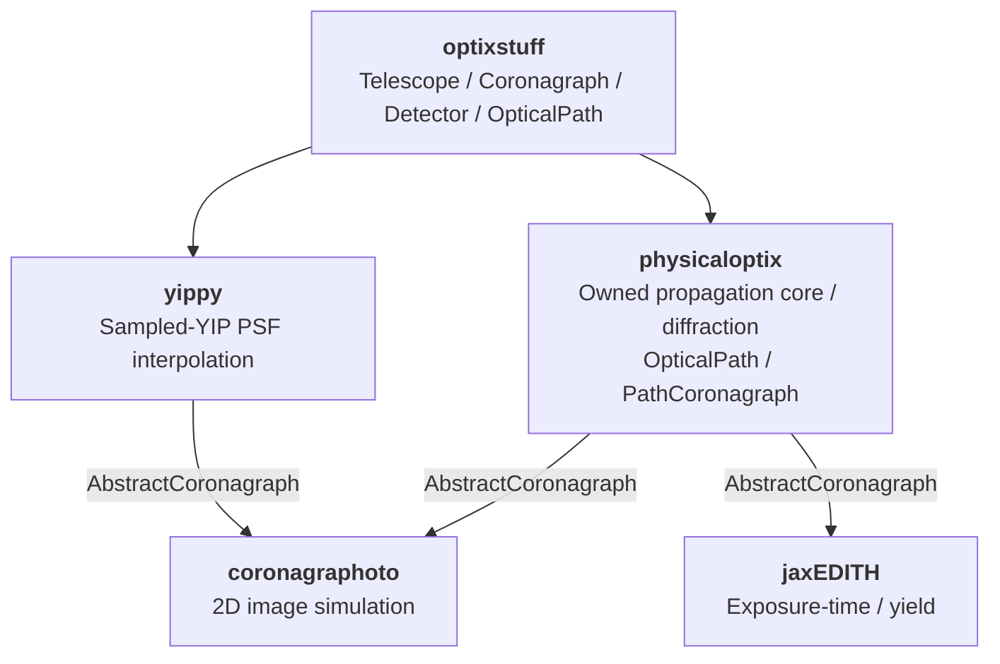

# physicaloptix

<p align="center">
  <a href="https://pypi.org/project/physicaloptix/"></a>
  <a href="https://physicaloptix.readthedocs.io"></a>
  <a href="https://github.com/CoreySpohn/physicaloptix/actions/workflows/ci.yml"></a>
  <a href="https://github.com/CoreySpohn/physicaloptix/blob/main/LICENSE"></a>
  <a href="https://github.com/CoreySpohn/physicaloptix/blob/main/pyproject.toml"></a>
</p>

Physical optics -- PSFs and diffraction -- for the HWO direct-imaging
simulation suite.

## What physicaloptix is

`physicaloptix` turns an [optixstuff](https://github.com/CoreySpohn/optixstuff)
hardware description into point-spread functions by wave-optics propagation.
It is a downstream consumer of optixstuff -- parallel to
[coronagraphoto](https://github.com/CoreySpohn/coronagraphoto) (2D image
simulation) and [jaxEDITH](https://github.com/CoreySpohn/jaxedith)
(exposure-time and yield calculations) -- so optixstuff itself stays free of
diffraction code.

The propagation core combines a plane-aware `Field` subclass of
`hwoutils.grids.GridArray` with shared `PixelGrid` geometry, the continuous-FT MFT pair, the
multi-scale vortex, and the `OpticalPath` fold with construction-time
sampling gates, validated against the HWO Coronagraph Design Survey
(cds_pipeline) EAC-1 AAVC to an on-axis null of 3.05e-11 (0.2 percent of the
reference; the acceptance gates live in `tests/validation/`).

The key piece is `PathCoronagraph`, which implements optixstuff's
`AbstractCoronagraph`: build an `OpticalPath` (entrance pupil to Lyot plane),
wrap it, and hand it to any downstream tool. Its IWA and scalar performance
curves are derived from the propagated PSFs at construction, never declared.
Aperture rules and performance reduction come from `optixstuff.apertures` and
`optixstuff.performance`; the sampled counterpart is `yippy.Coronagraph`, which
implements `AbstractTableCoronagraph` directly. `PathCoronagraph.bandpass` exposes
the recorded `Spectrum.band`, or `None` when no band was specified. Stellar maps
support point stars; nonzero diameters raise eagerly and return NaN under tracing.

Requires a configured optical path, pupil field, and output sampling.

```python notest
import physicaloptix as po
from hwoutils.grids import PixelGrid
from optixstuff import SimplePrimary

primary = SimplePrimary(circumscribed_diameter_m=6.0, collecting_area_m2=28.0)

coro = po.PathCoronagraph.from_path(
    core_path,
    pupil_field,
    primary=primary,
    reference_wavelength_nm=600.0,
    outer_working_angle_lod=32.0,
)
target = PixelGrid.focal(npix, 0.25, primary.frame(600.0))
psf = coro.on_axis_psf(600.0, target)  # per-pixel flux-fraction Image
eta = coro.throughput(6.0, 600.0)  # derived, not declared
```

## What physicaloptix is *not*

- **Not a hardware model.** The telescope / coronagraph / detector description
  lives in [optixstuff](https://github.com/CoreySpohn/optixstuff); physicaloptix
  consumes it.
- **Not a PSF interpolator.** That is [yippy](https://github.com/CoreySpohn/yippy)'s
  job (a sampled YIP table). physicaloptix is its functional sibling -- live
  propagation -- and both back the same `AbstractCoronagraph` slot.
- **Not a scene model.** Stars, planets, disks, and zodi live in
  [skyscapes](https://github.com/CoreySpohn/skyscapes).

## Architecture

Built on [JAX](https://github.com/google/jax) and
[Equinox](https://github.com/patrick-kidger/equinox), `physicaloptix` provides:

- **The field core** (`physicaloptix.core`) -- shared `hwoutils.grids.PixelGrid` (all-static, half-pixel
  offset, continuous-FT weights), `PlaneKind`-tagged `Field` pytrees, and
  `Spectrum` for chromatic fields.
- **Propagators** (`physicaloptix.transforms`) -- the validated `cmft_fwd` /
  `cmft_bwd` continuous-FT MFT pair and the plane-aware `Fraunhofer` wrapper
  (plus `FullBandFraunhofer`, its zero-padded FFT form on the full band),
  with sampling diagnostics evaluated at construction time.
- **Elements** (`physicaloptix.elements`) -- grid-stamped `SampledOptic` for
  ingested masks and the `MultiScaleVortex` ladder (hcipy port; reaches the
  cds EAC-1 on-axis null).
- **The optical path** (`physicaloptix.path`) -- `OpticalPath`, named plane-checked
  stages folded once, with static taps for free instrumented propagation.
- **The speckle layer** -- `SpeckleProcess` / `AnalyticSpeckleField`, the
  linear speckle generator (E_nom, G) behind optixstuff's `AbstractSpeckleField`.
- **Interop** (`physicaloptix.interop`) -- `PathCoronagraph`, the
  optixstuff `AbstractCoronagraph` adapter: cached-Lyot image interface and
  rule-specific curves (throughput, core area, leakage density, occulter transmission)
  derived from a build-time separation sweep.

### Ecosystem position



## Installation

```bash
pip install physicaloptix
```

## Status

Early development. The owned core propagates a full apodized vortex
coronagraph chain (see `tests/validation/`), and `PathCoronagraph` serves it
through the optixstuff interface with derived performance curves. The optical
model is scalar; the chain propagates broadband on a fixed angular grid, and
the yield-input-package emitter freezes it to tables.

## Verification and validation

The propagation core is verified against closed-form physics in tests that
run everywhere (the Airy pattern absolutely, the Mawet ideal-null theorem at
the 1e-11 contrast regime, Talbot and Gaussian-beam laws, gradient
correctness against finite differences) and validated against the HWO
Coronagraph Design Survey EAC-1 reference to a 0.2 percent on-axis null
agreement at 3e-11 contrast. The evidence, tolerances, and how to reproduce
them are documented on the
[validation page](https://physicaloptix.readthedocs.io/en/latest/validation.html).
The deep-contrast path requires float64 (`jax_enable_x64`).
